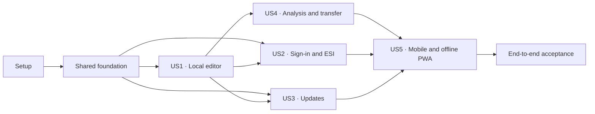

# Tasks · EVE Online Browser Fitting Assistant

**Inputs** · [Specification](spec.md), [plan](plan.md), [research](research.md), [data model](data-model.md), [acceptance](quickstart.md), and the [PWA and catalog](contracts/pwa-data.md), [EVE SSO and ESI](contracts/eve-esi.md), and [npm command](contracts/npm-scripts.md) contracts.

**Format** · `- [ ] TNNN [P] [USn] Action in a file`. `[P]` marks tasks in separate files that can run in parallel after shared prerequisites. `[USn]` identifies the user story. Paths are relative to the repository root. Prepare the listed automated checks and reproduce their expected failures before implementing the associated behavior.

## Phase 1 · Project Setup

- [X] T001 Verify stable versions and compatibility for Node, React, Vite, TypeScript, Playwright, and `eve-fit-engine` against `research.md`. Pin exact dependencies in `package.json` and `package-lock.json`, select the primary Node LTS in `.nvmrc`, and verify a clean `npm ci`.
- [X] T002 Set up browser entry in `index.html` and `src/app/main.tsx`, the shell in `src/app/App.tsx`, and Vite and `dev`, `typecheck`, `build`, and `preview` in `vite.config.ts`, `tsconfig.json`, and `package.json`. Type-check the client, Workers, and Node scripts. Build cleanly on the pinned Node and verify the supported local LTS.
- [X] T003 Set up `npm test` with `node:test` and `test:browsers` and `test:e2e` with pinned Playwright in `package.json` and `playwright.config.ts`. Use the production build and reproducible local snapshots for browser tests.
- [X] T004 [P] Ignore build output, reports, raw snapshots, and local environment files in `.gitignore`. Document the public `VITE_EVE_CLIENT_ID` in `.env.example`.

## Phase 2 · Shared Foundation

- [X] T005 [P] Add contract tests for the SDE snapshot shape, table versions, references, catalog sizes and SHA-256, and `initialize`, `search`, and `calculate` messages in `tests/contract/sde-import.test.ts` and `tests/contract/pwa-catalog-worker.test.ts`. Prepare a small reproducible fixture with a primary `tests/fixtures/sde/baseline/manifest.json`, JSONL, and schemas.
- [X] T006 [P] Define `Fit`, `FitItem`, and `SkillProfile` in `src/domain/fit.ts` and `src/domain/skills.ts`. Preserve stable IDs and original unknown item references. Assign local IDs to imports and copies, increment `revision` on save, and validate constraints independently of `draft` and `saved` states. Require unique slot positions, positive integer quantities, compatible charges, quantities, and states, and skill levels 0–5. Support `all-zero`, `all-v`, `custom`, and `eve` profiles and let players save invalid combinations as explained drafts.
- [X] T007 [P] Define `FitConditions` in `src/domain/conditions.ts`. Normalize nonnegative damage shares with a positive sum, verify units and ranges, allow sources to reference a pinned fit with its own profile, and check references and cycles before calculating.
- [X] T008 [P] Define `CatalogType`, `DogmaDataset`, `CompatibilityRelease`, `ChannelPointer`, and `InstalledCatalog` in `src/storage/catalog-contract.ts` and `src/fitting/dataset.ts`. Check schema, Worker protocol, rules, provenance, file size, and SHA-256. Resolve references within one `releaseId` and include engine and correction fingerprints in the rules version. Increase revision on publication and rollback and compare revisions on the client. Support `current`, optional `previous`, and `staging`, `verified`, `active`, `retained`, and `failed` states. Store `CompatibilityRelease` as an immutable verified combination.
- [X] T009 [P] Version the IndexedDB schema in `src/storage/database.ts` and `src/storage/migrations.ts`. Separate user records, the catalog, and the catalog pointer. Preserve original IDs through migration and allow clearing the catalog independently of the library.
- [X] T010 Implement `data:import -- --release <id> [--from <directory>]` in `scripts/data/import.ts` and `package.json`. Read the pinned CCP HTTP manifest or a local snapshot with `release`, `buildNumber`, `releaseDate`, `tables`, and `jsonl.url` and `jsonl.recordSchemaUrl`. Verify shapes, versions, and table references and record source and hashes. Use `releaseId` as the key, make repeat imports of identical data idempotent, and report hash mismatches for investigation.
- [X] T011 Normalize the complete Tranquility fitting catalog, including publication flags and referenced Dogma types, in `scripts/data/normalize.ts` and `scripts/data/artifacts.ts`. Build a name and category index and immutable type and Dogma segments. Include bonus, mutation, clone, fighter, and environment inputs. Write a manifest with files, sizes, and hashes under the PWA contract.
- [X] T012 Open, verify, and store the pinned starter catalog in `src/storage/catalog-bootstrap.ts` and `src/storage/catalog-store.ts`. Prepare the manifest and artifacts from an aligned snapshot for local builds in `scripts/build/bootstrap-catalog.ts` and `vite.config.ts`. Load the starter catalog before channel updates are implemented. Keep incomplete downloads outside the active pointer.
- [X] T013 Implement `pyfa:fixtures -- --from <directory>` in `scripts/pyfa/fixtures.ts` and `package.json`. Validate inputs, expected values, units, schema, provenance, and dataset fingerprint. Pin the representative initial Pyfa v2.70.0 fixtures, commit `e5483f8666ed2eda99c98985c59a29b07e3bb844`, and the matching data snapshot in `tests/parity/fixtures/baseline.json`.
- [X] T014 [P] Implement `initialize`, paginated `search`, and `calculate` in `src/fitting/fitting.worker.ts` and a browser `FittingDataset` adapter in `src/fitting/engine-adapter.ts`. Keep unknown entries and set affected results to `partial`. In `src/fitting/worker-protocol.ts` and `src/fitting/worker-client.ts`, use one snapshot per request, preserve fits when calculating, ignore stale replies, distinguish `computed`, `partial`, `unavailable`, `not-applicable`, and numeric zero, show results with their current snapshot, and store calculation inputs in the library. Load the needed pinned segments before calculation.
- [X] T015 [P] Implement `test:parity -- [--candidate <id>]` in `scripts/pyfa/parity.ts` and `package.json`. Use only aligned inputs, data, and rules. Require exact discrete values and statuses. For numbers, use the larger of 0.5% of Pyfa's value and half its display increment. Compare zero and non-applicability separately. Use the reference set by default and a selected candidate when supplied.
- [X] T016 Integrate T014 and T015 through `src/fitting/engine-adapter.ts` and `tests/parity/baseline.test.ts`. Verify the browser build, search, and calculation on one pinned catalog. Compare representative constraints, metrics, and effects to Pyfa. Record results and coverage gaps in `tests/parity/baseline-report.md` before expanding the editor and analysis calculations.

## Phase 3 · US1 · Create and Edit a Fit (P1)

**Goal** · Assemble, calculate, and save a working fit or draft locally.

**Independent test** · With the pinned catalog and no EVE sign-in, fit a frigate, change charges, drones, and a module state, and reproduce a resource violation and missing skill. Save a draft, duplicate and rename it, restart the browser, and restore a backup in a clean profile.

- [X] T017 [P] [US1] Cover hull search, recalculation, warnings, saving, copying, and restoration in `tests/e2e/editor-library.spec.ts`. Test conflicting saves of one revision from two tabs and library preservation on failed import.
- [X] T018 [P] [US1] Cover fitting constraints and original unknown references in `tests/unit/fit-validation.test.ts`. Cover backup versions, references, conflicts, and exclusion of session data in `tests/contract/backup.test.ts`.
- [X] T019 [US1] Implement finding, creating, saving, renaming, copying, and deleting fits and storing profiles, conditions, and settings in `src/storage/library.ts`. Check the expected revision before overwriting and write dependencies in one transaction. Keep unsaved inputs available for export if writing fails.
- [X] T020 [US1] Encode `Settings` and `Backup` with `formatVersion` in `src/formats/backup.ts` and prepare and apply transactional restores in `src/storage/restore.ts`. Back up fits, drafts, profiles, conditions, and preferences. Verify version and references, preview conflicts, and apply confirmed user records atomically.
- [X] T021 [US1] Validate slots, hardpoints, CPU, powergrid, calibration, skill requirements, charges, and drone and fighter limits in `src/domain/fit-validation.ts`. Associate violations with the item or resource. Extend `src/fitting/engine-adapter.ts` and `src/fitting/metrics.ts` to calculate capacitor, damage, volley, range, HP and EHP, resistances, repairs, velocity, align time, and targeting. Compare mining, remote support, skills, hull bonuses, and stacking penalties against the reference where applicable.
- [X] T022 [P] [US1] Add hull and item selection by name and category, attribute inspection, and suitable alternatives in `src/app/CatalogPanel.tsx`. Use paginated Worker search and include strategic cruisers, capitals, and fittable structures.
- [X] T023 [US1] Support high, mid, low, rig, subsystem, and service slots, hull modes, charges, drones, fighters, and cargo in `src/app/FitEditor.tsx`. Support adding, replacing, moving, deleting, quantities, and offline, active, and overheated states. Preserve the original equipment with a warning when slot counts change. Add all-0, all-V, and editable profiles in `src/app/SkillProfilePanel.tsx` and metrics, warnings, units, and statuses in `src/app/FitStats.tsx`.
- [X] T024 [US1] Implement local fitting search and library actions in `src/app/LibraryPanel.tsx`. Add backup download, conflict preview, replacement confirmation, and restore errors in `src/app/BackupDialog.tsx`.
- [X] T025 [US1] Connect the catalog, editor, library, and profile selection at `/` in `src/app/App.tsx`. Add visible focus, readable warnings, a neutral palette, and keyboard actions in `src/app/editor.css`. Keep the open fit exportable after save conflicts or quota problems. Run T017–T018 on the pinned catalog.

## Phase 4 · US2 · Connect a Character and Exchange Fits with EVE Online (P1)

**Goal** · Connect characters, use their skills, manage game fits, and estimate prices from public data.

**Independent test** · Connect two authorized test characters. Apply the selected character's skills, import a game fit as a local copy, upload a separate fit, and confirm its appearance and deletion for the intended character. Test partial pricing, access revocation, and an uncertain write while preserving local work.

- [X] T026 [P] [US2] Test five ESI operations in `tests/contract/esi-openapi.test.ts` using `tests/fixtures/esi/openapi-incompatible.json`. Cover methods, success codes, fields, IDs, scopes, compatibility dates, OpenAPI reference resolution, and a nonzero `--check` result for an incompatible snapshot.
- [ ] T027 [P] [US2] Prepare mocked SSO and ESI browser tests in `tests/e2e/esi-characters.spec.ts` and `tests/e2e/esi-fittings.spec.ts`. Cover two characters, expired `state`, concurrent token refresh, request cancellation, missing prices, denied scopes, rate limits, a full library, and lost POST and DELETE responses.
- [X] T028 [US2] Implement `esi:import -- --date <YYYY-MM-DD> [--from <openapi.json>]` and `esi:update -- --date <YYYY-MM-DD> [--check]` in `scripts/esi/import.ts`, `scripts/esi/update.ts`, and `package.json`. Pin the approved five-operation contract, requested date, provenance, and source SHA-256 in `src/esi/contract.snapshot.json`. Report route, code, field, and scope changes. `--check` reports changes and normal mode stages a candidate. Tie the approved snapshot to the client version and verify new dates with contract and adapter checks before building.
- [X] T029 [US2] Implement public Authorization Code with PKCE S256 in `src/esi/sso.ts`, `src/esi/token-validation.ts`, `src/esi/sessions.ts`, and `src/app/EveCallback.tsx`. Handle direct entry at `/auth/eve/callback` in `src/app/main.tsx` and connect with T028 scopes in `src/app/App.tsx`. Expire and consume `state` and verifier, clear callback parameters, and validate discovery, CCP endpoint URLs, JWKS and signature, issuer, both audiences, expiry, and `sub`. Keep access tokens in memory, refresh tokens per character in the initiating tab's `sessionStorage`, and coalesce concurrent refreshes. Document exact HTTPS callbacks, third-party code isolation, referrer policy, and network handling in `docs/static-hosting.md`.
- [ ] T030 [US2] Verify completed sign-in and refresh with a registered public client on an actual HTTPS origin. In a temporary browser check using T028, read test character skills, upload one test fit, and delete that entry in the same session. Record reproduction, results, scopes, callback availability, and blockers in `tests/e2e/esi-live.md` without codes or tokens. Do this before expanding protected features.
- [ ] T031 [US2] Implement typed Fetch and response validation against T028 in `src/esi/client.ts`. Use the five paths without trailing slashes, send `X-Compatibility-Date: 2026-11-19`, and accept earlier response dates for unchanged routes. Respect `ETag`, cache lifetimes, limits, and `Retry-After` with bounded read retries. Distinguish permissions, revocation, rates, a full library, and network errors. Cancel personal requests on context changes or disconnect and request scopes for the actions used.
- [ ] T032 [P] [US2] Implement `CharacterLink` and skills snapshots in `src/esi/characters.ts` and `src/storage/character-profiles.ts`. Support `linked`, `reauth-required`, and `disconnected` states. Store metadata separately from sessions and retain the skills snapshot on disconnect. Sync replaces the selected character's snapshot and hypothetical profiles use editable copies. Calculate with active levels and retain trained levels as metadata when available. Clear the session and stop character requests on disconnect.
- [X] T033 [P] [US2] Estimate public prices from `GET /markets/prices` and `average_price` in `src/esi/prices.ts` and `src/app/FitPrice.tsx`. Apply quantities and show the priced total, unpriced items, incompleteness, and retrieval time.
- [ ] T034 [P] [US2] Convert game and local fits in `src/esi/fitting-payload.ts`. Validate a name of 1–50 characters, a description of up to 500 characters, `ship_type_id`, and 1–512 `{type_id, flag, quantity}` entries. Map slots and storage flags, flag unsupported states, and create imported copies with new local IDs.
- [ ] T035 [US2] Implement `GET`, `POST`, `DELETE`, `RemoteFitRef`, and `RemoteMutation` in `src/esi/remote-fits.ts`. Record `characterId`, server `fittingId` when known, the representable fit fingerprint, and `pending`, `confirmed`, `rejected`, or `unknown` status. Keep the selected character context. Resolve uncertain writes using the response or by reconciling a refreshed list with ETag, ID, and fingerprint checks. Require the user to confirm a retry.
- [ ] T036 [US2] Wire characters, skills, price estimates, and game fits to `src/app/CharacterPanel.tsx`, `src/app/RemoteFittingsPanel.tsx`, and `src/app/App.tsx`. Show the character, skills timestamp, equipment and losses, separate upload and deletion confirmations with character and fit names, the operation result, and how to restore access. Preserve local use after sign-in cancellation, revocation, and network loss.
- [ ] T037 [US2] Run T026–T027 and manual acceptance in `quickstart.md` on two authorized test characters. Document context switching, applied skills, import, upload, deletion, and permission revocation in `tests/e2e/esi-live.md` without session data. Repeat the callback from an installed mobile PWA in T066.

## Phase 5 · US3 · Update Game Data and Pyfa Compatibility (P1)

**Goal** · Verify SDE and Pyfa changes independently, switch verified combinations atomically, and roll back while preserving the library.

**Independent test** · Publish A and B on a local channel with one `buildNumber` and different `release` values. Verify an updated attribute and saved records. Test corruption, incompatible schema, an interrupted download, quota, two tabs, and rollback at a new revision. Replay a Pyfa rule change and confirm recalculation on a matching build.

- [ ] T038 [P] [US3] Prepare CLI contract tests in `tests/contract/data-release.test.ts` and `tests/contract/pyfa-check.test.ts`. Cover same-build releases, changed reference inputs, unsupported effects, retries, a missing fresh report, concurrent publication, and rollback at a new revision.
- [X] T039 [P] [US3] Prepare two-tab, interrupted download, invalid hash, incompatible version, limited quota, local catalog loss, rules change, and rollback scenarios in `tests/e2e/catalog-update.spec.ts`. Verify the active version, data isolation, and preservation of fits, profiles, and settings. When removing a type, verify its original fit reference and `partial` status for affected metrics.
- [X] T040 [US3] Implement `data:update -- [--release <id>] [--check]` in `scripts/data/update.ts` and `package.json`. Resolve `latest` once and compare `release`, versions, hashes, `_changes`, and `_schemaChangelog`. Reuse matching verified tables. Report source, date, hashes, changes, state, and failure reasons in machine-readable form. Stage an immutable candidate in normal mode.
- [X] T041 [US3] Implement `data:verify -- --candidate <id>` in `scripts/data/verify.ts` and `package.json`. Verify completeness, format, references, significant effect support, and T015 parity. Keep versioned corrections with sources and coverage in `src/fitting/rules.ts`. Bind `verified` or `blocked` to manifest, input, and reference hashes and the verifier version. Require new aligned reference calculations when significant inputs change.
- [X] T042 [US3] Implement `pyfa:check -- [--ref <tag>]` in `scripts/pyfa/check.ts` and `package.json`. Resolve the stable tag and commit and identify rules and examples affected. Add `pyfa:fixtures -- --oracle <directory> --dataset <directory>` in `scripts/pyfa/fixtures.ts` and `scripts/pyfa/oracle.ts` to run pinned Pyfa in the maintainer's prepared Python environment. Approve new references after checking inputs, fingerprints, and results.
- [X] T043 [US3] Implement `data:publish -- --candidate <id> --target <local-or-configured>` in `scripts/data/publish.ts`, `scripts/data/channel-target.ts`, `vite.config.ts`, and `package.json`. Publish verified blobs and manifest, check availability, sizes, and hashes, and switch `current.json` atomically with an expected revision or single writer. Reread and recheck on conflict, retain the previous set, make repeating the current publication idempotent, and serve `local` at `/updates/` in `preview`.
- [X] T044 [US3] Implement `data:rollback -- --target <local-or-configured>` in `scripts/data/rollback.ts` and `package.json`. Verify the availability and compatibility of the previous combination and activate it at a new revision. Coordinate rules changes with the matching app build. Preserve the original user record format and let an open tab finish saving.
- [X] T045 [US3] Discover and activate catalog updates in `src/storage/catalog-update.ts` and `src/storage/catalog-store.ts`. Fetch `current.json` outside the shell cache, verify the manifest and required files, size and SHA-256, and confirm compatibility and expected local and remote revisions. Activate in a transaction and mark the previous release `retained` after validation. Keep incomplete downloads outside the pointer and retain a snapshot while work needs it. Reread the active release after races, keep a working set on corruption or quota failure, and use the retained release or T012 starter when compatible local data is missing.
- [X] T046 [US3] Show CCP release and `buildNumber`, rules version, Pyfa reference tag and commit, and update status in `src/app/CatalogVersion.tsx` and `src/app/App.tsx`. Switch new operations to the new `compatibilityId` through `src/fitting/worker-client.ts` after atomic activation. Retain pinned versions for active operations and tabs. Show the cause on failure and offer a download retry or backup restoration.
- [X] T047 [US3] Schedule separate SDE and stable Pyfa checks every four hours and on demand in `.github/workflows/verify-eve-updates.yml`. Keep version, diff, and failure reports, prepare verified candidates, and require an explicit publication target. Supply hosting credentials through the maintenance environment and exclude them and OAuth data from reports.
- [ ] T048 [US3] Run T038–T039 and the local channel procedure in `quickstart.md`. Record time to availability for two compatible releases, including a shared build number (within 24 hours), and time to a Pyfa change report (within one business day) in `tests/e2e/catalog-release.md`. Confirm a rules change with the matching build, reference recalculation, rollback, and preserved records.

## Phase 6 · US4 · Analyze and Transfer Fits (P2)

**Goal** · Compare fits under identical conditions, simulate complex effects, and transfer configurations with a clear preview of lost fields.

**Independent test** · Import a Pyfa example, compare it with an edited copy on the same profile, change the target, distance, and an external effect, verify updated charts, and export it back. In a separate import, preview and confirm transfer of the known entries.

- [X] T049 [P] [US4] Prepare 12 reference EFT, game XML, and DNA cycles in `tests/contract/fit-exchange.test.ts` using `tests/fixtures/formats/roundtrips.json`. Include multiple XML fittings, an unknown type, malformed entry, and extra states. Verify all representable fields survive.
- [ ] T050 [P] [US4] Cover comparisons, target and external effect changes, partial import, cancellation, and loss preview in `tests/e2e/analysis-exchange.spec.ts`. Verify that canceling and failures preserve the saved library.
- [X] T051 [US4] Define a common transfer result and validate representable equipment in `src/formats/transfer.ts`. Report unknown types, invalid source entries, and unsupported parameters. Import confirmed entries with new local IDs through `src/storage/library.ts`.
- [X] T052 [P] [US4] Implement EFT text in `src/formats/eft.ts` using compatible engine functionality and T051 validation. Retain unresolved source entries for preview.
- [X] T053 [P] [US4] Implement game XML in `src/formats/xml.ts`, including multiple fits in one file, record validation, and every representable field.
- [X] T054 [P] [US4] Implement DNA link import and export in `src/formats/dna.ts`. Validate IDs and quantities and list fields lost in transfer.
- [X] T055 [US4] Add text, file, and link exchange, error and loss previews, and partial transfer confirmation in `src/app/TransferDialog.tsx` and `src/app/App.tsx`. Offer text export from the open editor, including unsaved fits.
- [ ] T056 [US4] Implement incoming damage profiles, target and distance parameters, implants, boosters, Abyssal, environment, command, and projected effects in `src/fitting/effects.ts` and `src/fitting/engine-adapter.ts`. Resolve each external fit's pinned snapshot and profile, apply T007 reference and cycle checks, record current conditions, and refresh affected metrics.
- [ ] T057 [US4] Implement applied damage and capacitor charts in `src/fitting/graphs.ts` and `src/app/FitGraphs.tsx`. Use the same capacitor simulation's timeseries as the summary and distinguish partial, unavailable, and inapplicable results.
- [X] T058 [US4] Compare two or more fittings under a shared profile and conditions in `src/app/FitComparison.tsx`, `src/app/ConditionsPanel.tsx`, and `src/app/App.tsx`. Show equipment and metric differences, target, distance, and active effects. Recalculate when conditions change.
- [ ] T059 [US4] Build an aligned corpus of at least 30 fits in `tests/parity/fixtures/sc-001.json` and use it in `scripts/pyfa/parity.ts`. Include ships, structures, subsystems, skill profiles, overheating, charges, implants and boosters, Abyssal, effects, and chart checkpoints. Run SC-001, the 12 SC-004 cycles, and T050. Record discrepancies with inputs and versions in `tests/parity/sc-001-report.md`.

## Phase 7 · US5 · Use the App on a Phone and Offline (P2)

**Goal** · Use the editor by touch from 360 CSS pixels wide, install the PWA where supported, and access local fits after an offline restart.

**Independent test** · Find and add a module by touch, save the fit, wait for offline readiness, disconnect, and close the app. Reopen, locate, edit, recalculate, save, and export the fit. Test reconnection and library restoration to an installed PWA with separate storage.

- [ ] T060 [P] [US5] Prepare scenarios in `tests/e2e/pwa-offline.spec.ts` and `tests/e2e/pwa-transfer.spec.ts`. Cover 360 CSS pixels, cold start after preparation, search, recalculation, save, export, first open without local data, separate storage, operations after reconnection, and a shell update with two tabs open.
- [X] T061 [P] [US5] Create `/manifest.webmanifest` in `public/manifest.webmanifest` with ID, scope, start URL, and installed display mode. Supply the required sizes in `public/icons/icon-192.png` and `public/icons/icon-512.png`.
- [X] T062 [US5] Build `/sw.js` and a versioned shell resource list in `scripts/build/build-shell.ts`, `vite.config.ts`, and `package.json`. Include lazy modules, Worker, styles, and icons from the same build. Document short caching for HTML and the service worker, immutable assets, asset retention for open tabs and rollback, and HTTPS hosting in `docs/static-hosting.md`.
- [X] T063 [P] [US5] Precache the complete shell, activate safely, and start offline using the local catalog in `src/pwa/sw.ts` and `src/pwa/register.ts`. Keep the Worker and catalog aligned for open tabs. Fetch OAuth, ESI, callback, and `/updates/current.json` outside the shell cache. Retain a working shell after update failure and explain the first download when the app opens without data.
- [X] T064 [P] [US5] Switch between catalog, fit, and stats at 360 CSS pixels without horizontal page scrolling using `src/app/editor.css` and `src/app/EditorLayout.tsx`. Show the panels together on wide screens. Verify primary actions by touch, mouse, and keyboard and preserve visible focus when switching.
- [X] T065 [US5] Connect installation state, network-dependent features, and shell and catalog readiness in `src/pwa/readiness.ts`, `src/app/OfflineStatus.tsx`, and `src/app/App.tsx`. Request persistent storage where supported, explain quota issues, offer open-fit export and backup restore to separate storage, identify EVE actions that need connectivity, and keep local edits after reconnection.
- [ ] T066 [US5] Run T060 and SC-007 on desktop Chrome, Edge, Firefox, and Safari, Android Chrome, and iOS Safari. Verify supported installation, offline restart, backup transfer, and HTTPS callback return to the installed PWA on physical devices. Record browsers, conditions, and results in `tests/e2e/browser-acceptance.md` and add the mobile callback results to `tests/e2e/esi-live.md`.

## Phase 8 · End-to-End Verification and Release Preparation

- [X] T067 [P] Provide GPL-compatible distribution terms, notices, and corresponding source for the engine and browser build in `LICENSE` and `THIRD_PARTY_NOTICES.md`. Identify CCP data provenance and attribution and Pyfa materials separately.
- [X] T068 [P] In `README.md`, document clean builds, local acceptance, chosen snapshots, public client setup, static hosting, release preparation, and rollback. Verify script arguments against `specs/001-eve-fitting-pwa/contracts/npm-scripts.md` and `specs/001-eve-fitting-pwa/quickstart.md`.
- [ ] T069 Run `npm ci`, `npm run typecheck`, `npm test`, `npm run build`, `npm run test:parity`, and `npm run test:e2e` on a clean install using `specs/001-eve-fitting-pwa/quickstart.md`. Verify `dist/index.html`, `dist/manifest.webmanifest`, `dist/sw.js`, and assets. Inspect the bundle for Node scripts, tokens, and raw snapshots. Review SC-001 and SC-004–SC-007 reports and confirm that incompatible data and unsupported effects block promotion.
- [ ] T070 For SC-002, measure 40 searches and 40 typical fit changes after initial loading on a typical desktop and midrange phone. The p95 limits are 1 second and 500 ms. For SC-003, recruit ten first-time EVE players, at least five on phones and five on desktop. At least eight must create, save, and export a specified fit in five minutes without help. Record versions, devices, and results in `specs/001-eve-fitting-pwa/acceptance.md`.

## Dependencies and Work Order

- Start T026–T030 for US2 after the shared foundation. Character integration in the editor uses the US1 library and profiles. Complete live T030 before expanding protected features. Local work uses the pinned catalog.
- Start US3 CLI work after the shared foundation. Verifying user-data preservation requires US1 and a reference library. Local activation tests use aligned snapshots and verification reports. Full catalog release requires the SC-001 corpus from T059.
- US4 uses the US1 editor, profiles, and library. EFT, XML, DNA, and analysis tests use the pinned catalog. US5 acceptance uses T055 local export, US2 network states, and US3 catalog switching. Verify basic installation and offline editing using the pinned catalog.
- Coordinate changes to shared `package.json`, `vite.config.ts`, and `src/app/App.tsx` across phases. Live HTTPS verification requires a registered public client and authorized test characters. Mocked ESI scenarios run locally.

### Parallel Work Examples

| Story | Tasks that can run in parallel |
| --- | --- |
| US1 | T017 and T018 after the shared foundation. Browser and unit or contract tests use separate files. |
| US2 | T026 and T027 after the shared foundation. After T031, implement T032, T033, and T034 in parallel, then wire the game operations and UI. |
| US3 | T038 and T039 after the shared foundation. Command contracts and browser updates use separate test sets. |
| US4 | T049 and T050 after US1. After T051, implement T052, T053, and T054 independently. |
| US5 | T060 and T061 at the start. After T062, implement T063 and T064 in parallel, then connect state in T065. |

### Requirements and Release Criteria Coverage

| Requirements | Implementation and acceptance |
| --- | --- |
| FR-001, FR-012, FR-013 | T002, T025, and T060–T066. Verify SC-007 in T066. |
| FR-002, FR-003, FR-004, FR-005 | T006–T016, T021–T025, T032, and T056–T059. Verify SC-001 in T059 and SC-002 in T070. |
| FR-006, FR-008 | T049–T059. Verify the 12 SC-004 cycles in T059. |
| FR-007 | T009 and T017–T025. Verify the full SC-003 scenario in T070. |
| FR-009, FR-010, FR-011 | T026–T037 and T066. Verify the two-character portion of SC-004 in T037. |
| FR-014, FR-015 | T008, T010–T016, and T038–T048. Verify SC-005 and SC-006 in T048. |

## Implementation Strategy

1. Complete T001–T016. Verify a clean build and the initial Pyfa comparison on pinned data. Start T026–T030 HTTPS verification once a registered public client is available.
2. Implement T017–T025 for the first demo. Players can fit a frigate, calculate results, understand constraint warnings, and save and restore a fit without EVE sign-in. Verify the independent US1 scenario before expanding.
3. Complete the remaining P1 stories, US2 and US3, and verify them with authorized test characters and a local channel respectively. Add US4 and US5 to a test build and verify file exchange and offline restart.
4. Complete end-to-end acceptance before release. Reuse the current build for data-only updates with compatible schemas and rules. Verify changed rules and rollback across rules versions with the corresponding shell.
